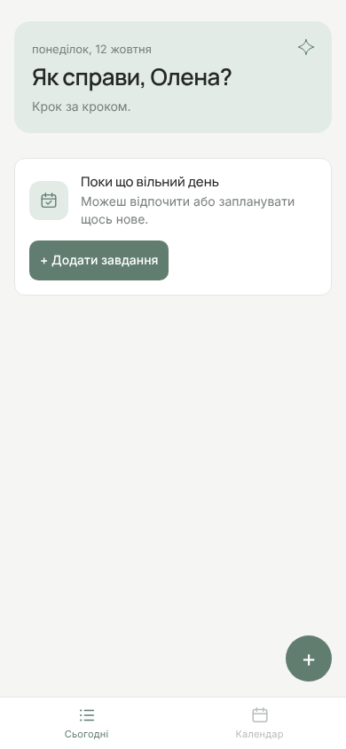
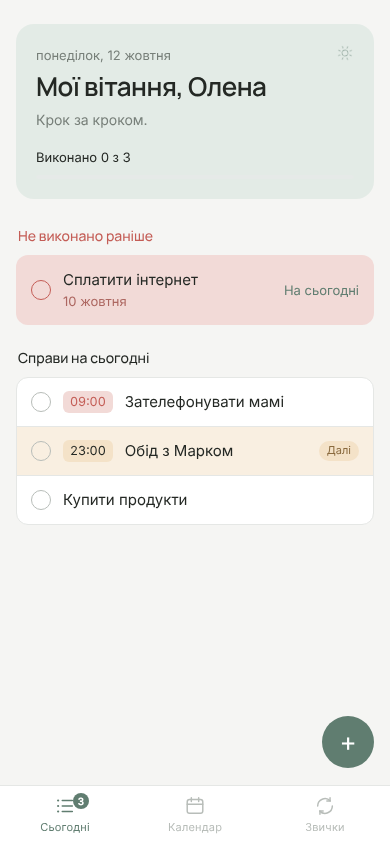
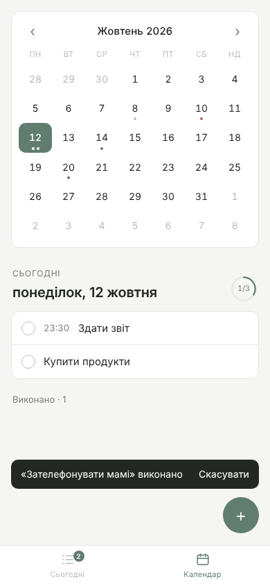
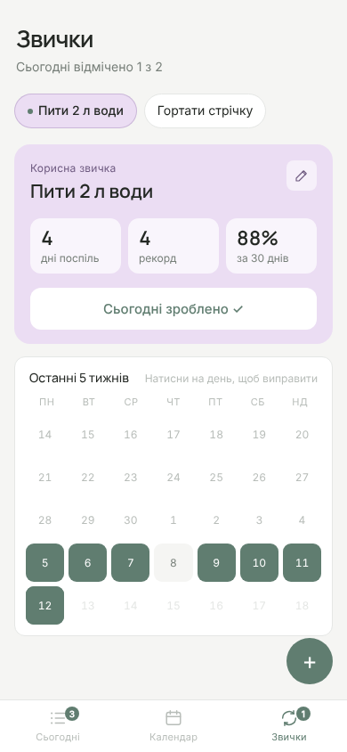
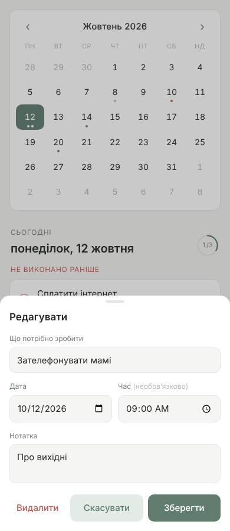

# Ritmoza — Telegram-бот + Mini App (прототип)


*Плануй · живи · розвивайся*

Щоденний планер усередині Telegram. Інтерфейс українською, мінімалістичний стиль, палітра Neutral Minimal.

- **Дві сторінки з нижнім меню**:
  - **«Сьогодні»** — список-нагадувалка: щоразу нове дружнє привітання на імʼя («Привітик, Олена», «Мої вітання, Олена», «Рада бачити, Олена», «Гарного ранку, Олена», «Затишного вечора, Олена»…), з урахуванням часу доби, дата, скільки справ залишилось і смужка прогресу, невиконане з минулих днів і справи на сьогодні. На вкладці — лічильник невиконаних справ.
  - **«Календар»** — місячний календар і план вибраного дня.
  - **«Звички»** — регулярні справи («пити воду», «зарядка») і шкідливі звички, яких хочеш позбутися («курити»). Людина додає їх сама, перемикається між ними, щодня відмічає і бачить прогрес: серію днів поспіль, рекорд, % за 30 днів і сітку останніх 5 тижнів (минулі дні можна виправити). Увечері бот нагадує про невідмічені звички з кнопками «✓».
- **Календар** на місяць: крапки під днями із завданнями (зелена — заплановано, червона — прострочено, сіра — усе виконано).
- **Додавання** завдання (кнопка «+»): назва, дата, час (необовʼязково), нотатка.
- **Редагування** — натисніть на завдання, щоб виправити помилку, перенести на інший день або видалити.
- **Виконано** — позначте кружечок, завдання переходить у згорнутий блок «Виконано» (можна скасувати).
- **Невиконане з минулих днів** показується на «сьогодні» з кнопкою «На сьогодні».
- **Нагадування від бота**:
  - за 15 хвилин до завдання, у якого вказано час;
  - увечері (за замовчуванням о 21:00 за місцевим часом), якщо на сьогодні лишилися невиконані завдання, — з кнопками «✓» і «→ Завтра» прямо в чаті.
- Команди бота: `/today` — план на сьогодні, `/add 18:30 Зателефонувати мамі`, `/tomorrow Купити хліб`.

## Запуск для користувачів (Railway)

1. **Створіть бота:** у Telegram відкрийте @BotFather → `/newbot` → назва `Ritmoza` → імʼя користувача, напр. `ritmoza_bot`.
   BotFather дасть **токен** і **посилання** `t.me/ritmoza_bot` — саме його надсилайте новим користувачам.
   Токен нікому не показуйте і не пишіть у чати.
2. **Аватарка:** у @BotFather `/setuserpic` → оберіть бота → надішліть `webapp/brand/bot-avatar.png`.
3. **Хостинг:** на https://railway.com → New Project → Deploy from GitHub repo → `vnssrsh-dot/planner`,
   гілка `claude/telegram-task-planner-proto-3mflfv` (збирається з `Dockerfile`).
4. **Змінні** (Variables): `BOT_TOKEN` = токен від BotFather.
5. **Диск для бази:** Add Volume → шлях `/data` (там зберігається `planner.db`, щоб справи не зникали після перезапуску).
6. **Публічна адреса:** Settings → Networking → Generate Domain. `WEBAPP_URL` підставиться сам.
7. Напишіть боту `/start` — зʼявиться план і кнопка «Відкрити Ritmoza».

## Демо в браузері (GitHub Pages)

У папці `docs/` лежать автономні демо (дані зберігаються в браузері, без сервера):
- `docs/index.html` — заповнений планер з прикладами;
- `docs/new.html` — порожній, як у нового користувача.

Щоб опублікувати: **Settings → Pages → Build and deployment → Source: Deploy from a branch**,
гілка `claude/telegram-task-planner-proto-3mflfv`, папка `/docs` → **Save**.
Через 1–2 хвилини демо буде за адресою https://vnssrsh-dot.github.io/planner/ (порожнє — `/planner/new.html`).

## Бренд

- `webapp/brand/mark.png`, `webapp/brand/wordmark.png` — знак і напис Ritmoza (прозорий фон).
- `webapp/brand/bot-avatar.png` — аватарка бота: завантажте її в @BotFather командою `/setuserpic`.
- Логотип показується на заставці під час завантаження і в шапці сторінки «Сьогодні».

## Палітра

| Роль | Колір |
|---|---|
| Основний фон | `#F5F5F3` |
| Картки і поверхні | `#FFFFFF` |
| Межі і розділювачі | `#E5E7E5` |
| Основний текст | `#242824` |
| Вторинний текст | `#777F79` |
| Основний акцент / виконані | `#607D70` |
| Світлий акцент | `#E3EBE6` |
| Термінові завдання | `#C45D56` |
| Неактивні елементи | `#B8BDB9` |
| Мʼякий блакитний — календар, час справ | `#DCE7F5` |
| Світлий абрикос — найближча справа «Далі» | `#F4E2C8` |
| Приглушений лавандовий — звички | `#EBDDF3` |
| Пудрово-кораловий — прострочене, термінове | `#F2DAD7` |

Кольори задані змінними на початку `webapp/style.css`.

Шрифти: **Manrope** (привітання, заголовки — 600/500) і **Inter** (текст, дати, кнопки — 400/500), з Google Fonts.

## Як влаштовано

```
planner/
  main.py       — точка входа: бот (long polling) + веб-сервер + цикл напоминаний
  bot.py        — команды и inline-кнопки бота
  reminders.py  — напоминания (проверка раз в минуту)
  api.py        — REST API для Mini App, проверка подписи Telegram initData
  db.py         — SQLite (пользователи, задачи)
  views.py      — тексты и клавиатуры сообщений
webapp/         — Mini App (HTML/CSS/JS без сборки, подстраивается под тему Telegram)
```

Стек: Python 3.11+, aiogram 3, aiohttp, SQLite. Часовой пояс пользователя берётся из Mini App
(до первого открытия используется `DEFAULT_TZ`).

## Запуск

1. Создайте бота у [@BotFather](https://t.me/BotFather) и получите токен.
2. Установите зависимости:
   ```bash
   python -m venv .venv && source .venv/bin/activate
   pip install -r requirements.txt
   cp .env.example .env   # впишите BOT_TOKEN
   ```
3. Mini App должна открываться по **HTTPS**. Для локальной разработки поднимите туннель на порт 8080:
   ```bash
   cloudflared tunnel --url http://localhost:8080
   # или: ngrok http 8080
   ```
   и пропишите полученный адрес в `WEBAPP_URL` в `.env`.
4. Запустите:
   ```bash
   python -m planner.main
   ```
5. Напишите боту `/start` — появится план на сегодня и кнопка «📅 Открыть планер» (а также кнопка «Планер» в меню чата).

### Посмотреть интерфейс в обычном браузере

Укажите в `.env` `DEV_USER_ID=1` и откройте http://localhost:8080 — API будет пускать без Telegram
от имени этого пользователя. **В проде оставьте `DEV_USER_ID` пустым.**

## Що можна додати далі

- Повторяющиеся задачи (каждый день / по будням / раз в неделю).
- Настройка времени вечернего напоминания из Mini App.
- Приоритеты и категории, перетаскивание задач между днями.
- Деплой: webhook вместо long polling, PostgreSQL вместо SQLite.

## Скріншоти

    
