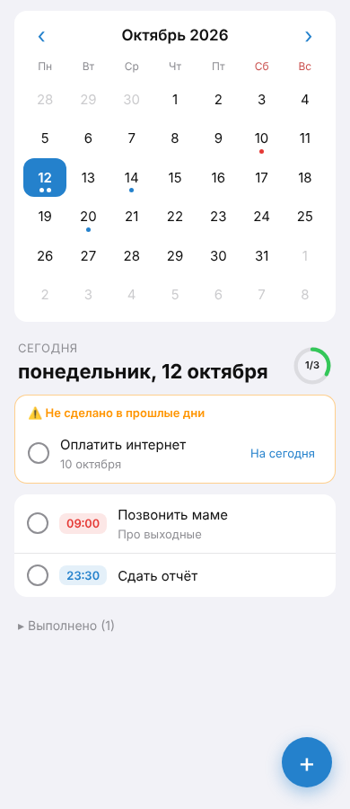

# Планер дел — Telegram-бот + Mini App (прототип)

Ежедневный планер внутри Telegram:

- **Календарь** на месяц: точки под днями с задачами (синие — запланировано, красные — просрочено, зелёная — всё сделано).
- **При открытии сразу видно, что запланировано на сегодня**, с прогрессом «выполнено N из M».
- **Добавление** задачи (кнопка «+»): название, дата, время (необязательно), заметка.
- **Редактирование** — нажмите на задачу, чтобы исправить ошибку, перенести на другой день или удалить.
- **Выполнено** — отметьте кружок, задача уходит из списка в свёрнутый блок «Выполнено» (можно отменить).
- **Хвосты**: невыполненные задачи прошлых дней показываются на «сегодня» с кнопкой «На сегодня».
- **Напоминания от бота**:
  - за 15 минут до задачи, у которой указано время;
  - вечером (по умолчанию в 21:00 по местному времени), если на сегодня остались невыполненные задачи — «🔥 День подходит к концу…» с кнопками «✅ выполнено» и «➡️ на завтра» прямо в чате.
- Команды бота: `/today` — план на сегодня, `/add 18:30 Позвонить маме`, `/tomorrow Купить хлеб`.

## Как устроено

```
planner/
  main.py       — точка входа: бот (long polling) + веб-сервер + цикл напоминаний
  bot.py        — команды и inline-кнопки бота
  reminders.py  — напоминания (проверка раз в минуту)
  api.py        — REST API для Mini App, проверка подписи Telegram initData
  db.py         — SQLite (пользователи, задачи)
  views.py      — тексты и клавиатуры сообщений
webapp/         — Mini App (HTML/CSS/JS без сборки, подстраивается под тему Telegram)
```

Стек: Python 3.11+, aiogram 3, aiohttp, SQLite. Часовой пояс пользователя берётся из Mini App
(до первого открытия используется `DEFAULT_TZ`).

## Запуск

1. Создайте бота у [@BotFather](https://t.me/BotFather) и получите токен.
2. Установите зависимости:
   ```bash
   python -m venv .venv && source .venv/bin/activate
   pip install -r requirements.txt
   cp .env.example .env   # впишите BOT_TOKEN
   ```
3. Mini App должна открываться по **HTTPS**. Для локальной разработки поднимите туннель на порт 8080:
   ```bash
   cloudflared tunnel --url http://localhost:8080
   # или: ngrok http 8080
   ```
   и пропишите полученный адрес в `WEBAPP_URL` в `.env`.
4. Запустите:
   ```bash
   python -m planner.main
   ```
5. Напишите боту `/start` — появится план на сегодня и кнопка «📅 Открыть планер» (а также кнопка «Планер» в меню чата).

### Посмотреть интерфейс в обычном браузере

Укажите в `.env` `DEV_USER_ID=1` и откройте http://localhost:8080 — API будет пускать без Telegram
от имени этого пользователя. **В проде оставьте `DEV_USER_ID` пустым.**

## Что можно добавить дальше

- Повторяющиеся задачи (каждый день / по будням / раз в неделю).
- Настройка времени вечернего напоминания из Mini App.
- Приоритеты и категории, перетаскивание задач между днями.
- Деплой: webhook вместо long polling, PostgreSQL вместо SQLite.

## Скриншоты

 
